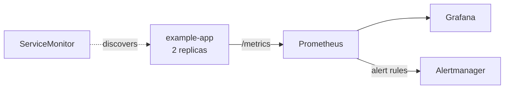
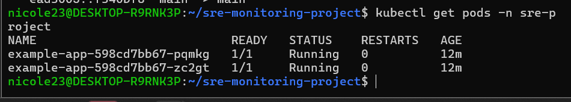
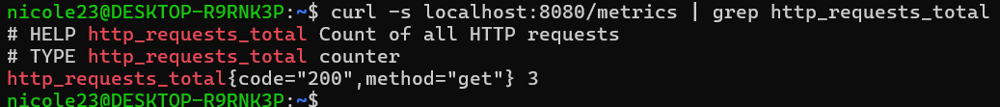
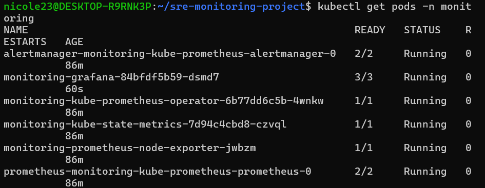
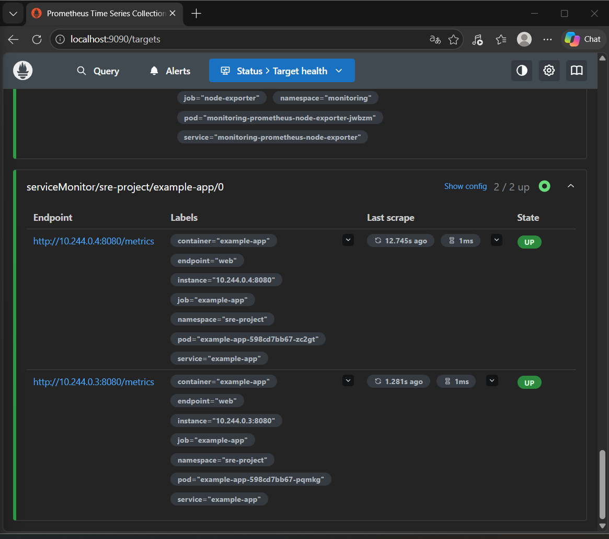
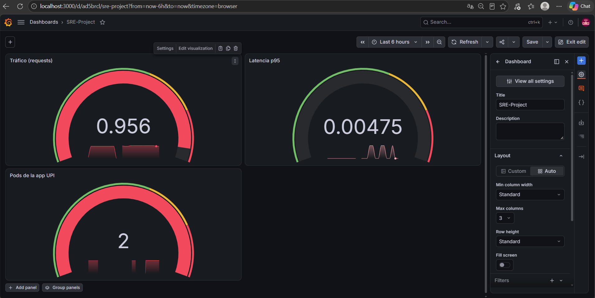
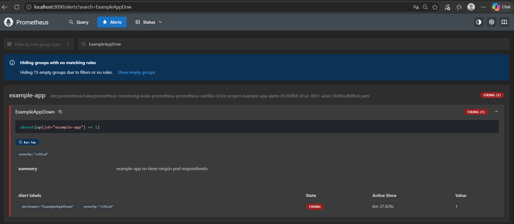
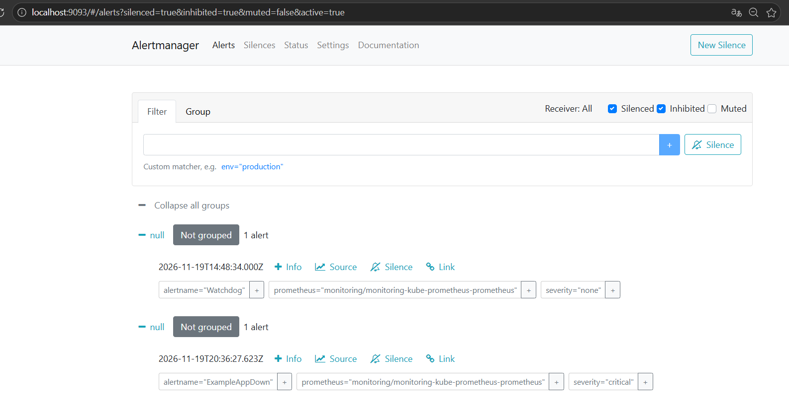

# SRE Monitoring Project

Observability stack on Kubernetes: an application exposes metrics, Prometheus scrapes them, Grafana visualizes them and Alertmanager handles the resulting alerts.

## Architecture



| Component | Role |
|---|---|
| `example-app` | Sample app (`prometheus-example-app`) exposing HTTP metrics at `/metrics` |
| Kubernetes (Minikube) | Runs the application and the monitoring stack |
| Prometheus | Collects metrics using the pull model (15 s scrape interval) |
| Grafana | Dashboard with traffic, latency and availability |
| Alertmanager | Receives and groups alerts fired by Prometheus |

## Repository structure

```
app/               Notes on the image in use
k8s/               Manifests: app, ServiceMonitor, alert rule
monitoring/        Helm values for kube-prometheus-stack
docs/screenshots/  Deployment evidence
```

## Prerequisites

Docker, kubectl, Minikube and Helm.

## Deployment

1. Create the cluster:
```bash
minikube start -p sre-project --driver=docker --memory=4096 --cpus=2
```

2. Deploy the application:
```bash
kubectl create namespace sre-project
kubectl apply -f k8s/app.yaml -n sre-project
```

3. Install Prometheus, Grafana and Alertmanager with Helm:
```bash
helm repo add prometheus-community https://prometheus-community.github.io/helm-charts
helm repo update
helm install monitoring prometheus-community/kube-prometheus-stack -n monitoring --create-namespace -f monitoring/values.yaml
```

4. Connect Prometheus to the app and create the alert rule:
```bash
kubectl apply -f k8s/servicemonitor.yaml
kubectl apply -f k8s/alert-rule.yaml
```

5. Access the UIs (one command per terminal):
```bash
kubectl port-forward svc/monitoring-kube-prometheus-prometheus 9090:9090 -n monitoring
kubectl port-forward svc/monitoring-grafana 3000:80 -n monitoring
kubectl port-forward svc/monitoring-kube-prometheus-alertmanager 9093:9093 -n monitoring
```

## Evidence

### Application running on Kubernetes


### Metrics exposed by the application


### Monitoring stack running


### Prometheus scraping the app (2 targets UP)


### Grafana dashboard
Panels: traffic (`rate` of `http_requests_total`), p95 latency (histogram) and pods UP.



### Alert firing
The `ExampleAppDown` alert fires when no app pod is responding.




## Incident simulation

1. Stop the app: `kubectl scale deployment example-app --replicas=0 -n sre-project`
2. The `up` series disappears and the alert goes Pending, then Firing (`for: 1m`).
3. Alertmanager receives the alert.
4. Restore: `kubectl scale deployment example-app --replicas=2 -n sre-project`

## Design decisions and lessons learned

- **Memory:** Grafana was `OOMKilled` with a 256Mi limit. Diagnosed with `kubectl describe pod` and raised to 512Mi in `monitoring/values.yaml`.
- **Infrastructure as code:** the stack configuration lives in `monitoring/values.yaml` and is applied with Helm.
- **Alerting:** the rule uses `absent(up{...} == 1)` because scaling to 0 replicas removes the `up` series entirely, so `up == 0` would never fire.

## Limitations and future work

- Alertmanager has no external receiver configured (Slack or email).
- No CI/CD pipeline.
- Grafana uses ephemeral storage: the dashboard is backed up by exporting it to JSON.
- The Grafana password in `values.yaml` is for lab use only; in production it would go in a Secret.

## License

See [LICENSE.md](LICENSE.md).
